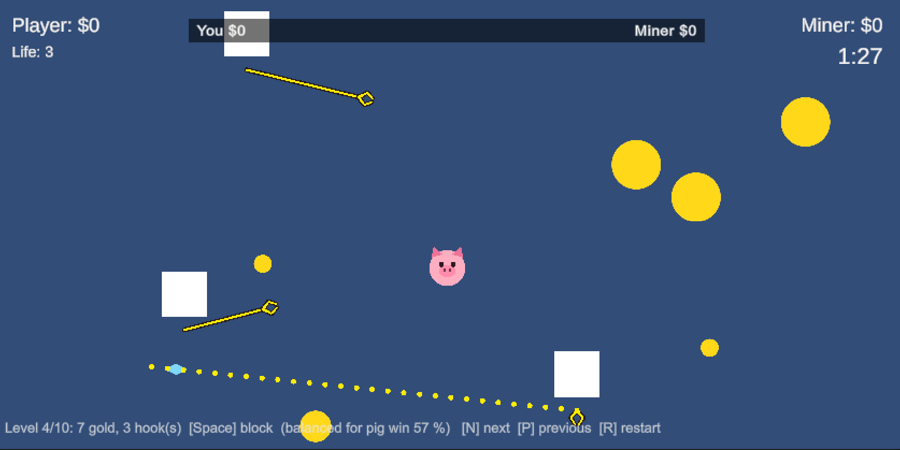
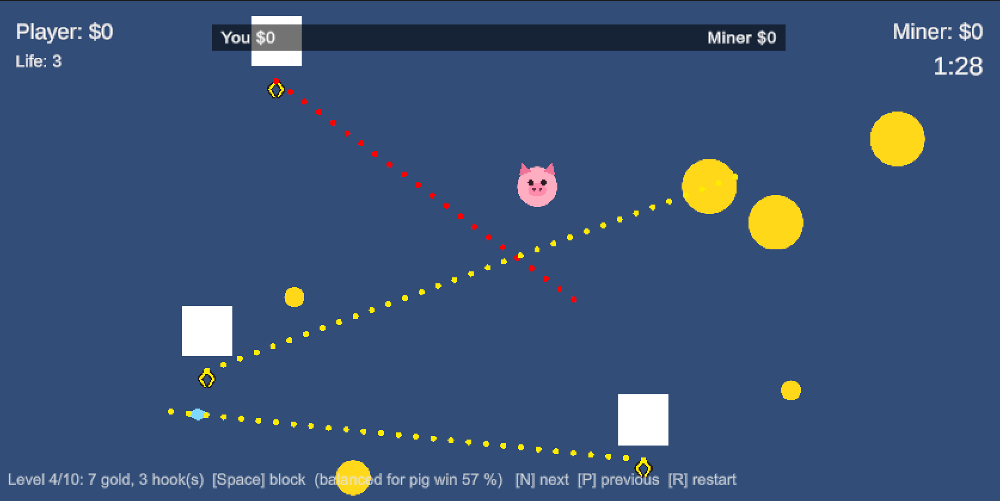

# Progress Report 10/15

## Game Mechanics
- With WASD as moving
- Gain more and more gold or dimond for money
- Win by gaining more gold than miner
- Using "Skiils" to survive

## Game Genre Design
- We are currently move from level based to Rogue Like with store
- Notice, one has to going through several tutorial level to understand the basic skills
- Notice that one might change the skills, for example: rush(cat), hook(frog).
- Notice that, one might create a kind of survival mode for stay alive while keeping gold for as long as possible
- Addition to that, one can spend money on tools that is easily consumed. Such as life, shield, bomb, and so on... 

## To-Do List
- UI redesign
- First design a linear like tutorial
- The menu for choosing different level
- The store for buying
- Different skill set attach to new characters
- Survival Mode

## Current Status

A snapshot of level 4, a few seconds after the round started:

| Where | What it shows |
|---|---|
| Bottom left | **Level 4 of 10**: 7 treasures (gold and diamond) and 3 hooks. Space blocks on this level. The simulator balanced it so the pig wins about 57% of the time. N / P / R load the next or previous level, or restart. 10 levels = 8 normal levels + 2 tutorials (eat, then block/steal). |
| Top left | **Player: $0**: money the pig has eaten so far. **Life: 3**: the pig starts every level with 3 lives, and the third hook hit ends the round. |
| Top right | **Miner: $0**: money the miners' hooks have brought home. **1:27**: time left in the 1:30 round. |
| Top centre | **Money bar**: pink fills from the left for the pig, gray from the right for the miner, sized by each side's share of the money so far. It's empty here because nobody has scored yet. |
| Centre | **The pig** (the player, moved with W A S D). Pink means it can eat and block. It turns green while digesting and blue while blocking, and the color drains from the ears down as the cooldown runs out. |
| Yellow circles | **Gold**: small $50, medium $100, large $250. This level has 3 large, 1 medium and 2 small. |
| Light-blue shape (bottom left) | **Diamond**, $600: the most valuable item on the level. |
| White squares | **The miners**, one per hook. Each hook's rope starts at its miner. |
| Yellow lines with a claw | **Hooks in flight**. Yellow means the hook is going for treasure. A red hook is aimed at the pig. |
| Dotted line | **Predicted path of the next hook**, shown before it fires. Here, the miner at the bottom right is about to go for the diamond (yellow dots). Red dots mean the next shot aims at the pig, so move or block. |

All the treasure on this level is worth $1,550. The round ends when the time runs out, all the treasure is gone, or the pig loses its last life. The pig wins with more money than the miner.

### When a hook aims at the pig

Each shot has a 30% chance to aim at the pig instead of treasure (never twice in a row). The miner then shows its path as **red dots**: it is trying to kill the pig. Each hit costs a life, and the third one ends the round.

- **The aim is locked when the red dots appear.** The miner at the top aimed at the spot where the pig was, and the dots run a little past it. The hook will fly along that line no matter where the pig goes.
- **Two ways to survive:** move out of the red line before the hook fires, as the pig here has already started to do, or press **Space** as the hook arrives to block it (the pig turns blue and the hook bounces off).
- **Yellow dots** are ordinary shots at treasure. Here, the left miner is going for a large gold and the bottom-right miner for the diamond. They aren't aimed at the pig, but any hook that touches it still costs a life, so don't stand in a yellow path either. If a hook drags treasure past you on the way back, press Space to knock it loose and eat it.