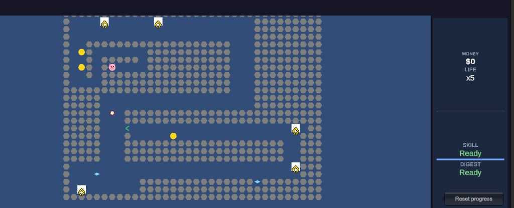
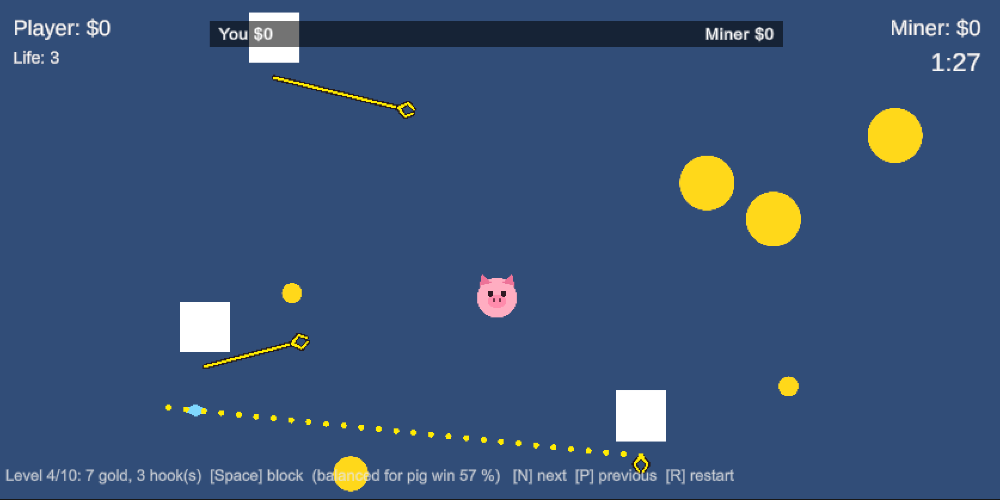
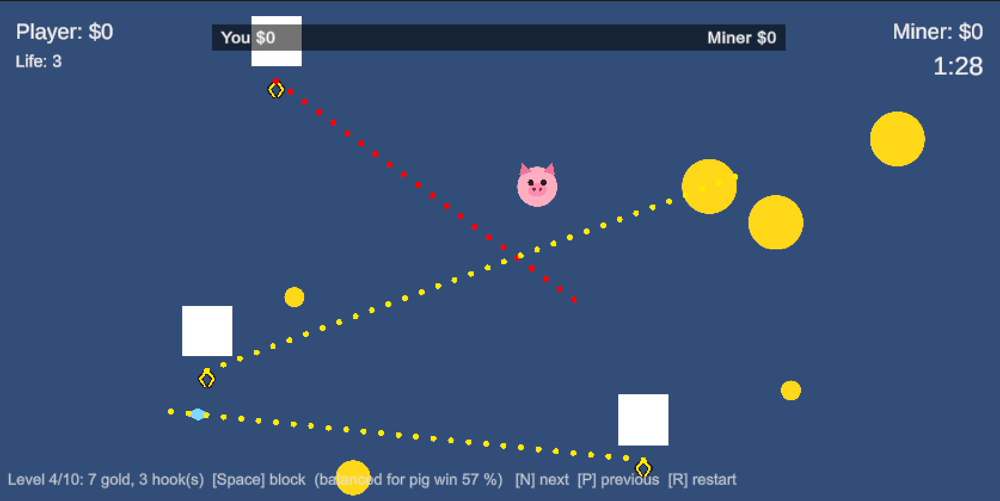

# Gold Miner

[Play in your browser](https://gold-miner-game.github.io/gold-miner/)

Current release: **gold-process**. Move with **WASD or arrow keys**, use **K** for
your character's skill, **J** to cut ropes, and **Escape** to pause.

Progression: **Tutorial → Level 1 → Level 2 → Store → Level 3**. Leaving the store
reveals Level 3. Level unlocks depend on completion, with no margin requirements.
Collected level earnings go into the wallet once per round. Store goods include
short gameplay previews on hover.

See [browser build instructions](docs/web-release.md) and
[current progression](docs/level-progression.md).

## Earlier progress report (10/15)

## Game Mechanics
- With WASD as moving
- Gain more and more gold or dimond for money
- Win by gaining more gold than miner
- Using "Skiils" to survive

## Game Genre Design
- We are currently move from level based to Rogue Like with store
- Notice, one has to going through several tutorial level to understand the basic skills
- Notice that one might change the skills, for example: rush(cat), hook(frog).
- Notice that, one might create a kind of survival mode for stay alive while keeping gold for as long as possible
- Addition to that, one can spend money on tools that is easily consumed. Such as life, shield, bomb, and so on... 

## To-Do List
- Cross Level Status Recorder (Top Priority, the memory for player, Zhan Li, merge to main, 10/17/2026, this means a base data class, everyone can inherent)
- UI redesign (Doeun Kim 10/17/2026)
- First design a linear like tutorial (Penny 10/17/2026)
- The menu for choosing different level (Penny 10/17/2026)
- The store for buying (Zhan Li, 10/18/2026) 
- Different skill set attach to new characters (Yukun Li 10/17/2026)
- Survival Mode (Butian Xiong 10/17/2026)

Map Design Concepts

UI Redesign

## Beta Design (goldMiner-beta)

Play it: https://gold-miner-game.github.io/gold-miner/goldMiner-beta/

### Logline
A competitive action game where players control an underground animal against AI miners: clear sectors of enemies, survive waves of hooks, and race the miners for treasure, using character abilities to block, attack, roll or steal.

### Player Goals / Win Conditions
Each battle level belongs to one of three modes, and each mode has its own goal:
- Attack: defeat every enemy in the sector. The player loses if they lose their last Life.
- Survival: stay alive until the timer runs out. Money does not decide the result.
- Compete: finish with more money than the miners combined when the timer runs out or all treasure is gone. A tie counts as a loss.

In every mode, losing the last Life ends the round immediately. In tutorial levels, the player wins by completing the assigned objectives.

### Game Description
Oinky Oinky reverses the roles of the classic Gold Miner. Instead of controlling the miner, the player controls an underground animal fighting AI miners for the same gold and diamonds. Players collect treasure by moving into it, with a digestion cooldown between pickups. Miners fire hooks to retrieve treasure or attack the player, and each shot is preceded by a dotted line that shows its locked trajectory: yellow for treasure and red for the player.

The game starts with three tutorials played back to back: eating treasure, dodging hooks, and blocking and attacking. The player then goes to the store and enters the world map, a maze the player walks through. Portals in the maze lead to the store, the character pick, and the battle levels. The map has three areas: Attack on the left (red), Survival in the middle (yellow), and Compete on the right (green). Most levels are hidden behind rocks and are revealed as earlier levels are cleared. In the beta, Levels 1, 2 and 3 are open, one per mode.

### Controls
| Input | Action |
|---|---|
| W/A/S/D | Move the character |
| Space | Mr. Hyde: block hooks and Red Squares (no damage). JK. Rolling: roll through hooks at a faster speed. Scrat: hold hooks in place with a firm tail. Rero Rero: use the tongue to collect or steal treasure. |
| Left mouse click | Mr. Hyde: attack. A fast slash sweeps a sixth of a circle around the pig. It points right, or at the closest enemy in reach, damages every enemy it touches and pushes them back. Also used to select menu items, buy store items, turn story pages, and use the Pause/Quit menu. |
| R | Restart the current level |

Note: Treasure is collected automatically on contact when the character is not digesting. Walk into a portal on the world map to enter it.

### Mechanics

- **Miner AI & Hook** (Core): AI miners compete with the player for treasure and target the player. In attack and survival levels, the miners walk: they follow the player around walls (A* pathfinding) and fire hooks from wherever they stand. Hooks travel along fixed paths and collect the first treasure they touch. Heavier treasure slows the hook's return, and miners earn points only when the hook reaches them.

- **Character Abilities** (Core): Mr. Hyde (the pig) blocks with Space and attacks with a left click; he is described as "defend and attack". JK. Rolling (the cat) rolls through hooks at a faster speed and damages enemies by rolling into them. Scrat and Rero Rero are still locked in the beta: they show as black silhouettes marked "???" on the character pick screen. Hovering over a character on the pick screen plays a preview of its skill.

- **Attack & Enemy HP** (Core): Attack levels place the player in a sector four times the size of the screen, with walls, and the camera follows the player. Two enemy types chase the player: the Red Round, a slow walking hook hole that shoots red hooks and has 4 HP, and the Red Square, which has no hook, moves faster, rams the player for a Life unless Mr. Hyde blocks it, and has 2 HP. Each enemy shows an HP bar over its head. Attack levels are always played as Mr. Hyde. Clearing every enemy wins the level.

- **Survival** (Core): Survival levels last one minute in a large walled arena. Six Red Squares that cannot be killed chase the player from the start, and more and more walking hook holes crawl out of the ground (one every 6 seconds, up to 10). Their hooks get faster and their warnings get shorter as the round goes on. Surviving until the timer runs out wins.

- **Compete & Time Control** (Core): Compete levels are a money race against green miners. Time moves only when the player moves: when the player stands still, the miners, their hooks and the timer slow to 6% of normal speed, so the player can stop and plan the next move.

- **Score Competition** (Core): In compete levels the player competes against the miners' combined score. Both totals remain visible throughout the round, and a top-bar money bar shows each side's share of the level's gold. The player wins only by finishing with more money. A tie counts as a loss.

- **Life & Damage** (Supporting): Each hit from a hook or a Red Square removes one Life unless the character is protected, followed by temporary invincibility. A Life bar over the player's head has one red segment per Life (three Lives = three segments); each hit empties one, and picking up a red heart fills one again. Losing the final Life ends the round immediately.

- **Level Progression** (Game System): After the tutorials, the player walks through the world-map maze. Portals lead to the store, the character pick, and the levels of the three mode areas (Attack, Survival, Compete). Clearing a level reveals the next portal hidden behind the rocks. Levels 1-3 are open in the beta; the rest are marked as coming soon.

- **Story** (Game System): Short story dialogues play in the tutorials, on the world map, in the store, and in each level. They explain the mode and introduce the characters. Pressing Start from the menu replays all of them.

### Twist & Mechanics Matrix (new mechanics)
| Mechanic | Description | Interaction with Twist | Affected Genre Elements | Supports |
|---|---|---|---|---|
| Attack & Enemy HP (Core) | The pig slashes enemies with a left click; walking enemies have HP bars. | The player hunts the miners instead of only avoiding them. | Combat, enemy AI, positioning | Character Abilities, Movement, Lives & Damage |
| Survival (Core) | Survive one minute against unkillable chasers and more and more hooks. | Turns the miners' hooks into a pure hazard to outlast. | Survival, evasion, escalation | Hook Telegraph, Movement, Lives & Damage |
| Compete & Time Control (Core) | Time slows to 6% while the player stands still. | Lets the player stop and plan each move in the money race. | Timing, planning, collection | Score Competition, Treasure Collection, Hook Telegraph |

### Mechanic Interaction Matrix (new mechanics)
- **Attack (Mr. Hyde)**: Treasure: none. Miner Hook: damages walking hook holes and miners and pushes them back. Player: points at the closest enemy in reach. Miner Score: a destroyed miner stops scoring.
- **Time Control (Compete)**: Treasure: none. Miner Hook: hooks and telegraphs slow to 6% while the player stands still. Player: time runs at full speed while the player moves. Miner Score: the miners collect more slowly while the player waits.

## Current Status

The maze hub is the world map: walk the grid, clear tutorial lessons (steal / block / knock), collect minerals for the maze bank, then enter Level 1 / Level 2 portals. Sidebar **MONEY** = maze bank + each battle's best (player − miner) margin. **Reset progress** (bottom right) wipes hub + unlock saves.

A snapshot of level 4, a few seconds after the round started.

> The level-4 screenshot predates the HUD redesign (PRs #15 and #19), so it still shows the old money bar and the bottom-left dev label. The tables below describe the current HUD.

The screen is split in three: a **top bar** (8% of the height), a **sidebar** on the right (14.3% of the width), and the **arena** in the rest. The camera fits the whole arena into that space, so the HUD never covers a hook or a treasure.

#### Top bar: this round

| Where | What it shows |
|---|---|
| Left | **Level**: the map node's name (e.g. `LEVEL 4`) when the round was opened from the World Map, or `LV 4/10` when the Game scene is played in the editor (N / P / R load the next or previous level, or restart). |
| Centre | **`$0 VS $0`**: the pig's money on the left, the miners' on the right. The side ahead is bold and the side behind is dimmed. A label flashes gold and a `+$600` popup rises when money comes in. |
| Right | **Timer** (`1:27` of the 1:30 round). It turns red under 10 seconds and pulses every second under 5. |
| Next to the timer | **Pause**: freezes the round and opens a *Quit Game?* popup. *Cancel* resumes, *Quit* goes back to the World Map. Only when the round was opened from the map. |

#### Sidebar: the pig and the run

A section with nothing to show is hidden (the tutorial has no wallet or items, for example), and dividers only appear between visible sections.

| Section | What it shows |
|---|---|
| **LIFE** | `x3`: lives left. Every level starts with 3, and the hit that takes the last one ends the round. Flashes red on a hit, green on a Life pickup. Hidden on rounds without lives. |
| **WALLET** | The run's money, carried between levels (and saved) and spent in the Store. From Level 1 on, a win adds how much the pig beat the miner by, and a loss takes that same gap away, so it can go below $0 (`-$150`). |
| **SKILL** | The champion's Space skill (block, roll, tail, tongue): `Active` while it runs, then the seconds until it is ready again with a bar filling up, then `Ready`. |
| **DIGEST** | `Ready` when the pig can eat, else the seconds left of digesting, in the digest's green. |
| **ITEMS** | One row per Store item held (`Shield x1`), including one that is armed or running, or `None`. The items are Swift, Ration, Shield and Brace. |

When the round ends, a panel covers only the arena and shows **YOU WIN** or **YOU LOSE**, the reason, the final `Player $ vs Miner $` score (with *"the miner wins ties"* on a tie), and what happens next (*Press R to retry*, *Back to the map...*). The top bar and sidebar stay visible.

In the tutorial, the stage's guide is drawn at the top of the arena with its progress (e.g. `Blocked 2 / 3`), and shrinks to its first line after 8 seconds.

#### Arena

| Where | What it shows |
|---|---|
| Centre | **The pig** (the player, moved with W A S D). Pink means it can eat and block. It turns green while digesting and blue while blocking, and the color drains from the ears down as the cooldown runs out. |
| Yellow circles | **Gold**: small $50, medium $100, large $250. This level has 3 large, 1 medium and 2 small. |
| Light-blue shape (bottom left) | **Diamond**, $600: the most valuable item on the level. |
| White squares | **The miners**, one per hook. Each hook's rope starts at its miner. |
| Yellow lines with a claw | **Hooks in flight**. Yellow means the hook is going for treasure. A red hook is aimed at the pig. |
| Dotted line | **Predicted path of the next hook**, shown before it fires. Here, the miner at the bottom right is about to go for the diamond (yellow dots). Red dots mean the next shot aims at the pig, so move or block. |

Level 4 has 7 treasures and 3 hooks. The simulator balanced it so the pig wins about 57% of the time. There are 10 levels: 8 normal levels and 2 tutorials (eat, then block/steal).

All the treasure on this level is worth $1,550. The round ends when the time runs out, all the treasure is gone, or the pig loses its last life. The pig wins with more money than the miner.

### When a hook aims at the pig

Each shot has a 30% chance to aim at the pig instead of treasure (never twice in a row). The miner then shows its path as **red dots**: it is trying to kill the pig. Each hit costs a life, and the third one ends the round.

- **The aim is locked when the red dots appear.** The miner at the top aimed at the spot where the pig was, and the dots run a little past it. The hook will fly along that line no matter where the pig goes.
- **Two ways to survive:** move out of the red line before the hook fires, as the pig here has already started to do, or press **Space** as the hook arrives to block it (the pig turns blue and the hook bounces off).
- **Yellow dots** are ordinary shots at treasure. Here, the left miner is going for a large gold and the bottom-right miner for the diamond. They aren't aimed at the pig, but any hook that touches it still costs a life, so don't stand in a yellow path either. If a hook drags treasure past you on the way back, press Space to knock it loose and eat it.

--- Penny Level Map ---
