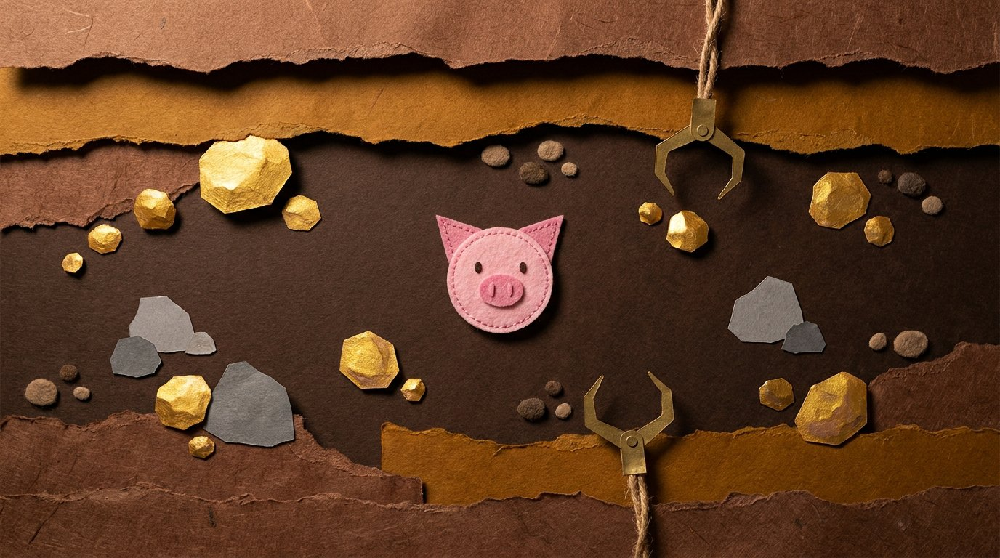
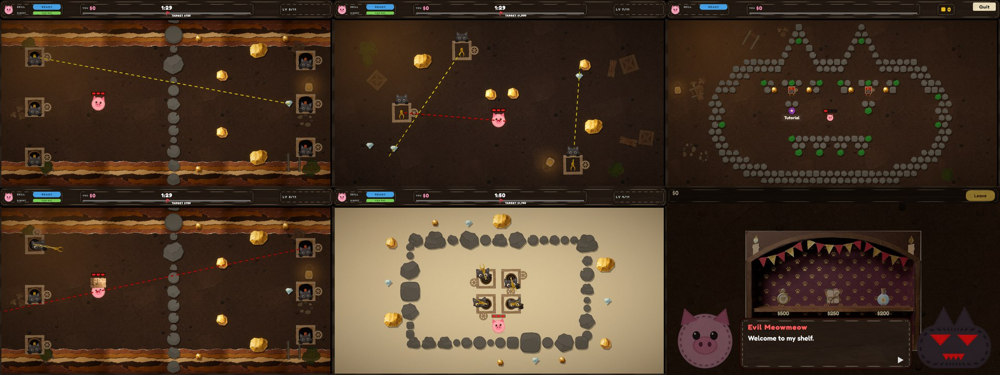
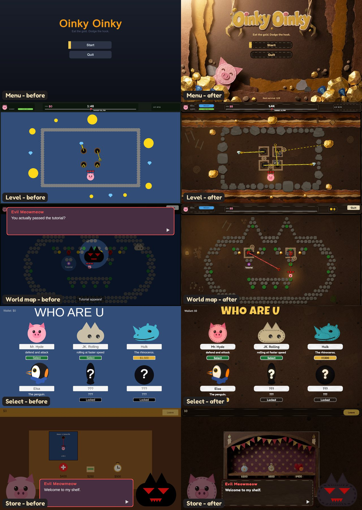
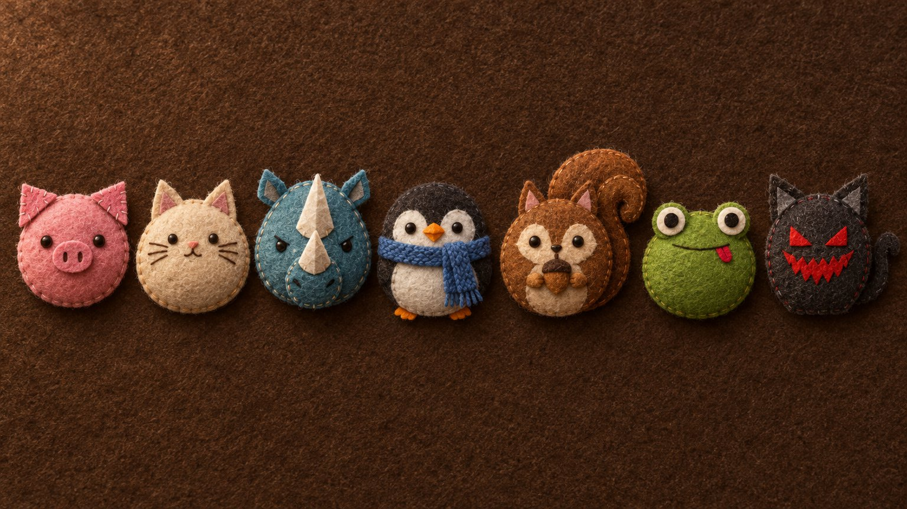

# Art style: Papercraft Gold Rush

Gold Miner looks like a handmade diorama seen from above. Everything is layered cut paper and wool felt, with
stitching, soft contact shadows and visible fibre. The floor is a dark, warm mine. Gold is the brightest, glossiest
thing on screen.

## The game now

Real screens from a build of this branch (captured with `tools/art_capture/capture.ps1`):

Before and after:

## Rules

1. **Readable first.** The floor is dark and low-contrast, and play pieces are lighter and saturated. A piece must
   read at 40 px on screen. No busy patterns under the playfield.
2. **One light.** Flat light from the top left, with a darker cut edge on the bottom right of shapes.
3. **Tints can be gameplay.** Some colours are rules, not decoration:
   - a green rock (`MapHub.GreenRock`) is rhino-proof;
   - map wall colours mark the mode areas.

   Anything whose colour code reads (`Rock`, `MapHub`) keeps its tint. Its art is light greyscale paper so the
   tint still colours it. Only art whose tint means nothing is shown in its own colours (`ArtLibrary.ApplyPainted`).
4. **Same footprint.** A new sprite covers exactly the box of the shape it replaces: 256 px = 1 unit, centred,
   edge to edge. Where gameplay reads a sprite's bounds (a carried treasure sits by them), the art is a full-rect
   sprite whose canvas is the old box (`ArtImportRules`). Colliders, scales and gameplay components are never
   changed for looks.
5. **Art has its own dice.** Effects draw from `ArtLibrary.Range/Value`, never `UnityEngine.Random`, so
   they can't shift what spawns or AI roll next.
6. **Art never changes gameplay.** No changes to rules, skills, timing, hitboxes or balance. If an effect has to
   hook into gameplay code, it only reads state, and it falls back to the old look when the art is missing.

## Characters

The heroes and the Evil Meowmeow are stitched felt. In the game they are still built from the circle, triangle,
capsule and square shapes, which are felt with a sewn seam, so every existing animation and skill works unchanged.
Pure-black enemy felt became charcoal (`#2B2426`) so it reads on the dark floor. The concept sheet above was made
with Meshy's Agent as the reference for future character art.

## Type

| Use | Font | Licence |
|---|---|---|
| HUD, buttons, dialogue, body text | Fredoka SemiBold | SIL Open Font License |
| Big titles | Luckiest Guy | Apache 2.0 |

Both fonts and their licences are in `Assets/Resources/Art/Fonts`. `PaperType` switches only texts still on the stock
fonts, so a font someone chose on purpose stays. A label built by copying an already switched label's font (the HUD's
Pause and end cards and round banner copy the clock's) is still judged: its `Title` / `Result` headline becomes a
gold title and shrinks to stay on one line.

## Scope

Only what the shipped game reaches from the Boot scene: Boot → Menu → tutorial levels / world-map hub
(`world_map`) → levels, Select ("WHO ARE U"), Store, Survival. The card map (`Map.unity`), `RolePick.unity`
and the Dev scenes are not reached and are left as they are.

## Palette

| Role | Colour |
|---|---|
| Mine floor | `#3B2A1E` (felt umber) |
| Torn-paper strata | `#6E4B33`, `#A9772E` |
| Gold | `#F2C230` to `#B8860B` (gold leaf) |
| Stone | light paper grey, tinted per use |
| Ink and outlines | `#211F20` |
| Slow-time cue | the floor cools toward `#8CBFB8` |

## Where things live

| What | Where |
|---|---|
| Painted sprites (generated with Meshy, cut with `tools/art/slice_sheet.py`) | `Assets/Resources/Art/` |
| Import settings for that folder (applied automatically) | `Assets/Editor/Art/ArtImportRules.cs` |
| Lookup used by runtime code; falls back to the old drawing | `Assets/Scripts/Art/ArtLibrary.cs` |
| Mine floor behind every orthographic scene, no scene edits | `Assets/Scripts/Art/MineBackdrop.cs` |
| Primitive shapes (circle, square, triangle, hexagon) | `Assets/Sprites/` |
| Prefab sprite swaps (Tools > Gold Miner > Art > Apply Papercraft Reskin) | `Assets/Editor/Art/PapercraftReskin.cs` |
| Screenshots of real screens in an isolated copy (no analytics, no save changes) | `tools/art_capture/capture.ps1` |
| Moments a scene load never shows (`level_02:win`, `:fail`, `:crush`, `:reward`, `:pause`, `:target`, `:hurt`, `Menu:confirm`) | `-Scenes` entries `NAME:action`, see `tools/art_capture/ArtCaptureRunner.cs` |

Small pieces drawn by code use the same materials:

| Piece | Look |
|---|---|
| Lives over the head | felt pips sewn on a dark felt strip (`Fx/LifePip`, 9-slice `Slices/FeltStrip`); red / orange / dark tints unchanged |
| Hook claw arms | rolled tin wire (`Tiles/Wire`), tinted by the hook colour like the twine rope |
| SKILL / DIGEST pills | the fill is a paper strip in the same colour, inside the rounded mask |
| Survival grid | quilting seams sewn into the felt (`Tiles/QuiltSeam`), same cell size and tint |
| Hook HP bar | the same sliced felt strip as the Lives, same green / yellow / red |
| Hook claw | a riveted tin hub at the pivot of the line-drawn arms (`PaperClaws`); nothing drawn past the arms, icy while frozen |
| Rocks and walls | flat 2D cut-paper stones, two or three torn layers seen from above (`Objects/Stone1..9`, `PaperRocks`); the hexagon was only a level-design placeholder. Each stone boils on the boil clock, keeps its tint (green = rhino-proof, map colours; every green tile, rock or hidden level, is the same faceted Stone3 so it still reads as rock in green; an open level's breathing and reveal stay smooth, because they scale the portal's trigger), and shrinks its drawing to 0.96 x the distance to its nearest rock so stones never overlap; stones draw two steps under their rock's order, so gold and characters always lie on top; colliders untouched |
| Hub rocks | the Evil Meowmeow's built trap: every rock drawn the same size (0.96 of its cell), shapes from the chunky set; green tiles (unrevealed levels) share one shape and size |
| Hidden portals | drawn as the same stones while disguised (`PaperPortalStones`), with the rocks' shadow, boil and fit, so the secret holds; the hexagon returns as the reveal starts |
| Lamplight | warm pools on the floor only, never over a game piece: a soft mine lamp from the top left (the cover's light) and each lantern prop; no lamp follows the player, so the character stands in the same shade as every other cut-out; flicker on the boil clock, and each lamp breathes brighter and dimmer on its own period, never in step (`PaperLamps`) |
| Set props | flat cut-paper and felt (crate, lantern, moss, mushrooms, pebbles, plank, rail, rope), replacing the earlier photo-like props |
| Elsa's frost | the rim's noise is torn paper and fibre (`Tiles/PaperFrostNoise`, same mean and contrast) and its drift steps on the pose clock; colour timeline, coverage and every freeze rule untouched. The breath flipbook is kept: its measured front is used by the freeze logic |
| Hook claw (keyframe) | brass cut-out: riveted hinge plate and two curved prongs rooted at the real pivot, reaching the real tips; the drawn opening steps through held angles on the pose clock (closing 40/28/16/10/12, opening 12/26/43/40); brass tinted toward the hook colour (`PaperClaws`) |
| Miners | after the classic gold-mining arcade miners who work a winch: every burrow is a mine shaft (cut-paper timber frame) with a twine reel that turns a held pose at a time, paying out and cranking back; a felt Meowmeow sits on the rim and acts out its hook (idle, leaning in as it fires, straining as it reels, red glare on a shot at you), facing its hook. In levels with the old Miner prefab, its 1x1 paper-square body (gameplay: frost freezes the miner through it) stays enabled at alpha 0 and the cat stands on that spot above the shaft, like the classic miner over the hole. While its hook rests, the cat sits in front of the claw; while the hook is out, the rope and claw pass over it. Frozen by Elsa, the felt cat and its paws turn the same ice-blue as a frozen claw and hold their pose until they thaw (the body's own frost overlay cannot show on the hidden square). Level start: every shaft opens with a board hatch (`Miner/HatchFlap`, cut from the plank prop): closed, a rattle, the flaps swing down into the shaft, then the cat pops up, overshoots and settles (9 held poses, about 1.1 s, a pose apart per shaft, inside the miners' 1.5 s start delay; if a hook fires first the intro just ends). Battle levels and Survival holes, not the world map (`PaperMiners`) |
| Strata and floors | the keyframe's torn-paper sandstone strata (rust, ochre, sand, umber; Meshy) frame level 3 (`level_02`) alone. Every other battle level keeps the plain felt mine floor, tinted its own way per level (warm clay, red earth, ochre near the top; cold charcoal, deep slate and the darkest gallery deeper down), so each level has its own ground. The hub keeps its dark dungeon floor; Survival its felt mat (`PaperStrata`, `Tiles/Strata`, `MineBackdrop`) |
| Hook cable | the keyframe's casual two-ply jute twine (Meshy-painted): two strands in a lazy twist with open eyes between them, drawn along each rope's exact points. The gameplay rope stays enabled (frost reads it) but is held at alpha 0, so the eyes are truly empty; it shows again only while frost patches lie on it. The pattern is pinned at the hook and never stretches, so paying out reveals more twists at the burrow. Jute lightly dyed toward its owner's colour, icy while frozen; the brass claw is drawn 1.3x larger so the twine has a plate to tie onto (`PaperClaws`, `Tiles/Cable`) |
| Shield | a flat kraft box worn on the head (`Fx/PaperHelmet`, cut from the Meshy paper bag's folded cuff, with a lit lid): it covers just the part above the eyes, ears and horns included, so it reads as worn, with its front edge resting just above the eyes, and is only as wide as the cut-out, so it barely grows the character's outline; sized from the whole cut-out, so it fits every character. Eyes, the face below and the digest tint and cooldown overlay stay in view. When the shield runs out it tears into three pieces cut from the box (`Fx/HelmetPieceA/B`: the front's two halves, flung sideways; `C`: the lid, popped up) and fall away over five held poses with a felt puff, only on a real expiry mid-round. The store's Shield item shows the same box (`Icons/shield`) (`PlayerCharacter`, `PaperSkillFx`) |
| Red Square | a red felt block with a stitched seam and an angry ink face (`Objects/RedSquare`), same one-unit bounds and red tint |
| Money target | felt pennant flag (`Fx/Pennant`); "past the target" stripes stay the miner's lavender and white, as felt and paper (`Tiles/PaperStripes`) |
| Map | paper star on portals, paper chevron on one-way doors, place names on felt tags (`PaperTags`) |
| IMGUI defaults | default-skin buttons are paper cards, default boxes are stitched felt (`PaperType`) |
| Titles | display font, gold leaf (if white), umber outline, paper drop shadow (`PaperType`) |
| Pause and end cards | stitched felt cards, restyled the frame they appear (`PaperUI` checks the canvases every frame). Buttons are the main menu's stitched felt buttons with gold lettering (red for Quit); the default one (Resume, Retry, Back to Map) has the menu's gold paper tab; key badges are paper key caps (`ArtLibrary.PaperCap`); a held button's stitched-on label sits lower until release (`PaperPress`). The pause divider is a row of stitches; the end card's YOU / TARGET bar is a paper strip with a pig-pink paper fill and the HUD's red pole and felt pennant at the target. Clicks, keys and layout unchanged (`PaperPopupSkin`) |
| Lost life | still HUDController's own soft red edge glow, untouched; a papercraft version is parked for a later pass |
| "Digesting…" cue | a paper tag behind the label, same pulse |

Effect sprites are generated by `tools/art/make_fx.py` and short numpy snippets
(white or cream, so code tints still apply).

The primitive shapes were repainted in place with `tools/art/paperize.py`. Their files, alpha shapes and physics
outlines are unchanged, so every shape-built character, rock and map tile picks up the paper look automatically.

## Animation: the stop-motion rules

Research notes:

- Feature stop-motion is shot **on the pose clock**: each pose held for 2 frames, 12 poses per second at 24 fps. At that
  rate it reads nearly smooth. The hand-made, visibly choppy look comes from **threes and fours** (8 and 6 poses
  a second), and that's the look this game wants (the user's playtest: 12 still felt too fast).
- Stepped motion only reads as crafted when the poses themselves ease, ramping into a move and settling out of it.
- A **boil** is 2–3 redrawings of the *same* registered pose. The silhouette stays put and only the surface and
  edges shimmer.
- In papercraft games (Tearaway, Blender Studio's papercraft devlog), the world animates "at a lower frame-rate
  akin to stop motion". Characters use swappable sticker parts (replacement animation) instead of rigs.

The rules that follow:

1. **Gameplay never steps.** Movement, hooks, collisions and timers stay smooth at full frame rate, because
   input feel is gameplay. Only art-owned motion is stepped: effects, UI transitions, idle life.
2. **One shared beat.** Every stop-motion picture changes on the same beat, `StopMotion.Frame`: 8 pictures a
   second of running time (real-rate even in slowed tutorial prompts and the time machine), stopped while the game
   is paused. `StopMotion.Time` is the game time when the current picture was taken. Movement holds, eyes, rock,
   roll, pips and claws all read this one beat, so nothing changes between another part's steps.
3. **Poses, not jitter.** Every art move is anticipation, action, settle. Each has a held first and last pose.
4. **Boil keeps registration.** Boil frames may change surface and edge pixels only, never position, rotation
   or scale. They run on `StopMotion.Boil` (6 poses a second), so the surface feels handled, not shaken.
5. **Pause means still.** Art motion uses the game's (scaled) time, so a paused game is a still photo of the set.

The first attempt at a treasure "boil" (random sprite jitter, removed) broke rules 3 and 4. It moved the whole
cut-out, so it read as shaking.

### Performances

The original game showed most states with a colour change. These performances were added on top. All are
art-only and posed on the pose clock.

| Moment | Performance | Where |
|---|---|---|
| Idle | blinks every 2–5 s, an occasional ear flick | `PaperPuppet` |
| Moving | eyes look where it goes; ears trail the motion and overshoot when it stops | `PaperPuppet` |
| Eat | gulp (eyes pop wide), content squint, gold-leaf burst and ring | `PaperPuppet`, `PaperFx` |
| Digesting | chewing: ears wiggle alternately on the boil clock, eyes held half closed (no flutter) | `PaperPuppet` |
| Block (Mr. Hyde) | one-pose wind-up, then ears pinned back and eyes squeezed; dust ring | `PaperPuppet` |
| Roll (JK. Rolling) | dust kicked up behind the cat each time she turns (no ring) | `PaperSkillFx` |
| Charge (Hulk) | ears flat back, felt steam puffs left behind | `PaperPuppet` |
| Shield | the paper box keeps its size and rocks with the head (same tip, same beat), then tears when time runs out | `PaperPuppet`, `PaperSkillFx` |
| Hit | flinch (eyes clench, ears flatten), felt heart scraps fly | `PaperPuppet` |
| Evil Meowmeow | eyes narrow in a glare, teeth chatter | `PaperPuppet` |
| Hook shot | dirt puff at the burrow | `PaperPuppet` |
| Treasure | registered boil on the boil clock; one light-catch star at a time | `PaperShadows`, `PaperFx` |
| Rock (stopmotion on) | the set rocks in counterpoint on one shared beat (`StopMotion.Rock`: -1, -1, 0, +1, +1, 0 on the pose clock, 0.75 s): treasure on the floor tips 3 degrees with it (`StopMotion.RockDegrees`, the gentle nudge of a hand-set cut-out) (pre-drawn `NAME_r1/_r2`, same canvas), while every character and the Meowmeows tip 3 degrees against it (a walking puppet's sway joins the same tip, whole body, ears and eyes together, never on their own rhythm; the miner cats tip their head and body from just above the paws while the paws stay planted on the rim, redrawn still on top from each pose's bottom band `Miner/MinerX_paws`) | `PaperShadows`, `PaperPuppet`, `PaperMiners` |
| Holds (stopmotion on) | the moving cast is drawn on the pose clock too: characters (and their life pips), treasure in a claw and the Meowmeows are shown where they stood at the last picture of the shared beat (so slowed tutorial prompts still step at 8 a second), drawn by offsetting collider-free child cut-outs and a stand-in for a root body sprite, never by moving a physics root (`PaperHolds`); the twine and brass claw redraw only on a new pose (`PaperClaws`), the aim stitch holds its aim (`TelegraphLine`). Movement, hooks and aiming stay smooth underneath; only the picture steps | `PaperHolds`, `PaperClaws`, `TelegraphLine` |
| Life / reel-in / smash | felt-heart burst / dust puff / paper crumbs | `PaperFx` |
| HUD numbers | the label stamps: big, smaller, settled | `PaperHud` |
| Titles appear (results, WHO ARE U) | stamped in: big, smaller, small overshoot, settled (unscaled time, so paused result screens still play it) | `PaperType` |
| Swift | no effect on purpose: the extra speed is the feedback (afterimages read as noise in playtest) | |
| Block / Brace | no paper effect: the body turning blue (`BlockFlash`) says it; the stitched guard ring was removed in playtest as clutter | |
| Roll (JK. Rolling) | on each beat the rolling cat turns, a fan of felt dust kicks out behind her (`PaperFx.Kick`, no ring); in stop-motion mode the spin turns exactly a quarter turn on each beat, four beats a revolution, so the default 0.5 s roll lands upright (the true spin seen by gameplay is unchanged) | `PaperSkillFx`, `CatController` |
| Time machine | the floor layer (felt floor, strata, props, lamplight) bleaches toward warm white paper in held fifths as time slows, so every game piece stands out in full colour; the earlier clock face and the teal floor tint are gone | `PaperSkillFx` |
| Treasure in a claw | hangs and swings from the grip in held poses (+4, rest, -3, rest), pre-drawn on the same canvas so the grip is unchanged | `PaperShadows` |
| Round won | cut-paper confetti falls over the whole screen (result screen included) and sways; unscaled twos; swept away when the next round starts | `PaperConfetti` |
| Round cues (goal / Target reached banner, TARGET flag swell) | HUDController's timing, shown on the pose clock in unscaled time: the banner is put down whole and grows into place in held poses (its title stamps in) and thins away pose by pose; the flag swells in held poses. Values are put back before HUDController's Update, so it never reads a held one | `PaperPopups` |
| Life lost / gained | the felt pip over the head pops (big, smaller, settled) as it empties or fills | `PlayerLifeBar` |
| Block lands | a pop-up card shield (three nested paper half discs) pops open, overshoots, holds, folds flat | `BlockFlash` |
| Attack (Mr. Hyde) | a torn-paper slash sweeps round; it leaves in two held steps | `AttackSwing` |
| Skill cooldown / Hulk charge | the tint fills the felt body up to a torn-paper edge; the charge spreads as a hand-cut disc | `PlayerCharacter`, `RhinoController` |
| Hook aim (telegraph) | a running stitch of twisted thread, whole line shown at once; stitches march toward the target on the pose clock | `TelegraphLine` |
| Scene change | felt curtain holds, dips, is pulled away | `PaperCurtain` |
| Start / Continue | the felt sticker is pulled by its gold tab and peels left to right (suggested by the team); poses held on the boil clock (corner lifts and holds, a third, two thirds, curled, flips off); the scene load waits for the 0.75 s peel | `MainMenu` |

`PaperPuppet` works as an additive pose layer. Before any script's `FixedUpdate` or `Update`, every part it posed
is put back exactly as it was. After every `LateUpdate`, it re-poses them for the picture. Gameplay and the
existing skill animations always read and write the true values. Only child art parts move, never a root or
anything with a collider.
