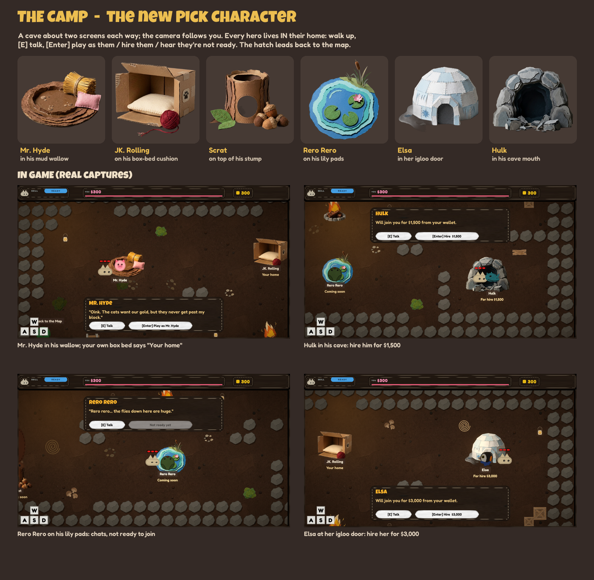

# The camp: the new Pick Character

The world map's **Pick Character** node no longer opens the old "WHO ARE U" screen. It opens the
**camp**, a safe cave in the mine where the heroes live. You walk in as your current hero, meet
the others at their homes, talk to them, and swap to them, hire them, or hear that they are not
ready yet. There are no hooks, no clock and no run record here.

## Layout

`Assets/Resources/Hub/camp.json` is a "grid" level (like the world map) with `"camp": 1`:

- **Size:** 36 x 20 tiles at tile 1.0, about two screens each way. The camera shows one screen and
  follows you inside the cave, as Level 4 (the roam map) does.
- **Scale:** heroes stand at their battle sizes (each prefab's own scale, Mr. Hyde at 0.8), so they
  sit in a place that fits them instead of a screen-sized box.
- **Centre:** a campfire plaza, framed by four small rock outcrops.
- **Gate:** the hatch "Back to the Map" sits in the west notch, and you arrive just inside it.
- **Hulk's cave** is a real walled chamber in the south-east, with its mouth toward the fire.
- Hulk can smash the camp's rocks with his charge. All rocks return whenever the camp is entered again (including after switching heroes); camp damage is not saved with world-map damage.

Each hero has a home that suits them, painted in the keyframe's cut-paper style (Meshy):

| Hero | Home | State on main today |
| --- | --- | --- |
| Mr. Hyde | stands in his mud wallow (hay bale, pink pillow) | unlocked |
| JK. Rolling | sits on the cushion in his cardboard box bed (yarn ball) | unlocked |
| Scrat | sits inside his hollow stump, face over the rim, tail rising out (acorns) | not released: "Coming soon" |
| Rero Rero | stands on a big lotus leaf in the middle of his pond | not released: "Coming soon" |
| Elsa | stands in her igloo's doorway | for hire, $3,000 |
| Hulk | stands in his rocky cave's mouth | for hire, $1,500 |

Every hero lives **in** their home, not beside it. Each spot's `home_anchor` is where in the
painting the hero stands, measured 0..1 from its bottom-left: the mud basin, the box's cushion, the
stump's top, the lily pads, the igloo's door, the cave mouth. The painting is placed so that point
lands on the hero, and `home_size` is the painting's width. Name tags go under whichever reaches
lower, the hero or the home. The anchors were measured from the paintings (a flood fill of the mud
basin, the cushion, the stump's hollow, the lily leaf, the igloo door and the cave opening), not
guessed. Each friend hangs from a pivot at the centre of its own drawing (the squirrel's tail left out), so
it sits and turns about its middle. Three homes also have a **front** piece (`Home_*_Front`, the
painting below a cut line), drawn over the hero, so the hero sits inside: JK. Rolling behind the
box's front flap, Scrat inside his stump with his face over the rim and his tail rising out, and
Hulk behind the rubble at his cave mouth. Your own home says "Your home". The others are at theirs as friends: they sway on
the shared stop-motion beat and turn to face you. A hero for hire is a little dimmed, and an
unreleased one dimmer still. Name tags and states sit under them on the usual felt tags.

## What you can do

Walk up to a friend, within about 2 units, and a felt talk card opens on the half of the screen
away from them. It asks whether you'll go on an adventure together. Choosing a hero takes two
presses of Enter, so a stray key never spends the wallet:

- **[E] Talk:** three beats per speaker/visitor pair, cycling. `CampDialogue.cs` contains 30
  conversations (90 unique beats), selected using the NPC and the currently controlled character.
  Scrat's bracketed action beats are text descriptions, not new animations. Talking works with or
  without the pop-out open.
- **First [Enter]** (or the card's button): the hero's recorded skill clip **pops out** on the side
  of the screen away from them (`CharacterSkillDemo.ShowInFrame`, the same clips as the old pick
  card). The pop-out is just the clip: every key hint stays on the talk card, whose button now reads
  "[Enter] Play as …" or "[Enter] Hire $…". The talk card moves aside, so the two never overlap.
- **Second [Enter]** (or the card's button):
  - unlocked hero: **play as them**. The camp re-opens after a short fade, with you standing at
    their home and your previous hero now at theirs.
  - for hire: **hire them** for the price, paid from the wallet (`CharacterUnlocks.TryPurchase`).
    The top bar shows the wallet. The pop-out stays open, and a further [Enter] plays as them.
- **Walking away** closes the pop-out. Esc stays the pause key.
- **Not released** (Scrat, Rero Rero): no pop-out. They chat, but they're not ready to join yet.
- **The hatch:** back to the map. It completes the Pick Character node, as picking did on the old
  screen. Leaving without a pick counts as picking whoever you are.

Picking keeps the old screen's rules: `ChampionSpawner.Chosen`, a fresh record that keeps store
goods, the save (`ProgressStore.SelectedCharacter`), analytics, and the tutorial events
`RolePickOpen`, `CharacterPicked` and `Picked(i)`.

## Dialogue direction

User-selected references guide personality and manner of speaking ONLY. Do not transfer their
professions, hobbies, biography, relationships, titles, signature props, plot events, or catchphrases.
Any new interests or anecdotes must be independently grounded in this game's characters and camp.
Keep the dialogue in English. Both sides of a pairing should reflect these personalities.
Keep exactly three beats per pairing. Vary the subject across pairings: weather, food, hobbies,
enemy encounters, memories, cave conditions, everyday annoyances, and hopes for the surface.
References guide delivery and motives; they do not restrict every exchange to a character's defining
trait. Quiet, casual conversation belongs here too. New anecdotes are camp fiction, not imported lore.
Animal habits and existing camp objects are valid material: Rolling can chase her yarn or groom,
Hyde can sniff things out, Rero can catch flies, and Elsa can enjoy sliding. Let personality shape
their reaction to these experiences. Avoid making every line demonstrate the same trait.
Treat A speaking to B and B speaking to A as separate encounters with different topics, not two
halves or retellings of the same event. Each direction still has exactly three beats.

| Hero | Reference | Voice and tension |
| --- | --- | --- |
| Mr. Hyde | Shirou Emiya / 卫宫士郎 | Earnest, practical, stubbornly altruistic; helps before thinking and struggles to accept care himself. Avoid the old gruff caretaker voice. |
| JK. Rolling | Eriri Spencer Sawamura / 泽村·斯宾塞·英梨梨 | Proud, competitive, sensitive to criticism, hungry for recognition, awkward about showing care. No inherited artist role or painting hobby. Avoid reducing every line to a denial of affection. Replaces the earlier Chitanda reference. |
| Scrat | Scrat, Ice Age | Squeaks, gestures, fixation on an acorn, escalating physical comedy; briefly generous before obsession wins. Avoid fluent speeches. |
| Rero Rero | Utena Tenjou + Touga Kiryuu / 天上欧蒂娜＋桐生冬芽 | Protective idealism mixed with cultivated charm, probing questions, and the temptation to make others dependent. Can question his own motives. No inherited prince identity or story. Avoid the old sleepy pond sage. |
| Elsa | Anon Chihaya / 千早爱音 | Outgoing, image-conscious, eager for approval; embarrassment gives way to imperfect but active kindness. Avoid the cold queen stereotype. |
| Hulk | Jules Winnfield, Pulp Fiction | Deliberate conversational authority, everyday rituals and moral questions; strength under control and an effort to choose restraint. This replaces the earlier superhero Hulk reference. Avoid caveman speech. |

## Code

- `CampHub.cs` builds the camp and runs it.
  - **Friends:** each is the playable prefab, instantiated while inactive and stripped of every
    script, collider and rigidbody before it wakes, so nothing can mistake it for the player. It
    then gets a small static body. The squirrel keeps `SquirrelTailHeading`, with simulation off,
    so its tail stays in its standing pose.
- `LevelLoader.SetUpHub` adds `CampHub` instead of `MapHub` for a camp level, and skips the world
  map's saved spot there.
- `GameFlow` opens the camp for the Pick Character node, and the old Select scene is the fallback
  when `Hub/camp` is missing. `GameFlow.InHub` now includes the camp, so the HUD treats it as a
  hub: no clock, the wallet on the bar.
- Art: `tools/art/make_camp.py` builds `Art/Camp/Campfire_1..3` (the fire flickers on the boil
  clock and casts a lamp pool) and `Art/Camp/Home_*` from `docs/images/camp/`.
- Capture: `tools/art_capture/capture.ps1 -Scenes "camp,camp:talk,camp:hire,camp:soon,camp:switch,camp:gate"`.

Checked in real builds: arriving, talking, the hire card, the coming-soon card, switching
(the camp re-opens as the new hero) and the hatch (back to the world map as the new hero).
Not exercised: a hire that succeeds, because the capture wallet held $300.
