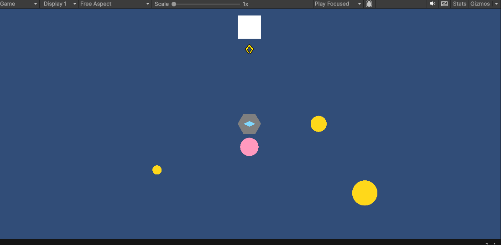

# Hook

Owner: D (Hook & UI) — script: `Assets/Scripts/Hook.cs`

The claw under the miner (white square) is the hook at rest. It is drawn with lines in code,
so it also shows in edit mode. No sprite or prefab is needed.

## Behavior

- **Color**: yellow hook = aimed at treasure, red hook = aimed at the pig. Color is passed in by `MinerAI` through `Fire(from, dir, length, color)`.
- **Path**: flies along the locked telegraph line, to the target plus `overshoot` (0.6).
- **First valid object rule**: stops at the first treasure, rock or pig on its path. Walls and Life items are passed through.
  - Treasure: grabbed, the claw closes, and the miner is paid at once.
  - Rock: flashes and blocks the hook.
  - Pig: `GameManager.PlayerHit()`, whatever the hook color.
- **Retract**: an empty hook still reacts to what it touches on the way back. A hook that carries something ignores everything else.
- **Weight**: heavier treasure is pulled back more slowly (speed multipliers below).
- **Round end**: a hook in flight comes back to the miner instead of freezing.

## Inspector

| Field | Default | Meaning |
|---|---|---|
| `extendSpeed` / `retractSpeed` | 12 / 16 | Units per second |
| `smallGoldSpeed` / `mediumGoldSpeed` / `largeGoldSpeed` / `diamondSpeed` | 1.0 / 0.7 / 0.45 / 1.1 | Retract speed multiplier per treasure type |
| `hitRadius` | 0.2 | Size of the collision circle |
| `defaultColor` | yellow | Color when `Fire` is called without one |
| `lineMaterial` | (sprite material) | Material for the rope and claw lines |
| `ropeWidth` | 0.05 | Rope thickness |
| `outlineColor` / `outlineWidth` | dark brown / 0.03 | Dark border around the rope and claw |
| `clawLength` / `clawWidth` | 0.35 / 0.06 | Claw size |
| `clawOpenAngle` / `clawClosedAngle` | 40 / 12 | Arm angle (degrees) when open / holding treasure |
| `clawCloseSpeed` | 10 | How fast the claw opens and closes |
