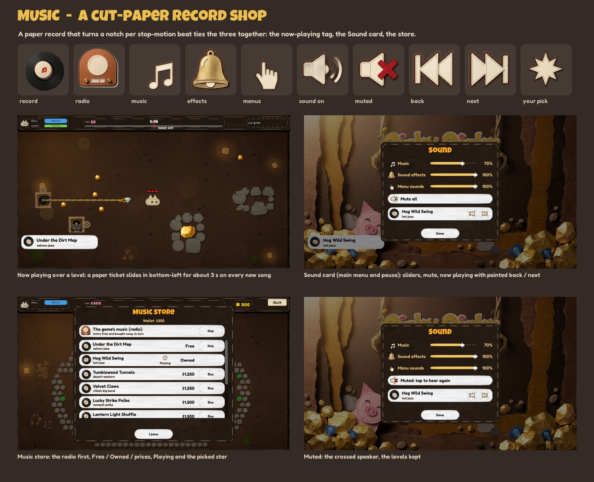

# Music art: now playing, the Sound card, the record shop

The three music screens share one picture: a **cut-paper record**, a black paper disc with a cream felt
label and a red stitched note. It turns a notch per stop-motion beat whenever a song is playing. It
is drawn from 12 pre-cut turns (`Music/Record_00..11`), so it looks the same in scroll views, scaled
GUI frames and over the pause popup. It runs on real time, because the store and the pause popup
freeze the game.

## 1. Now-playing tag (`NowPlayingTag`)

- Every new song (`SoundDirector.SongChanged`: the radio, a store pick, survival) slides a small
  paper ticket in at the bottom left. It shows the turning record, the title in Fredoka and the style
  underneath, for example "Dig It Disco / funk disco".
- It slides in over three held poses, stays about 3 seconds, and slides out.
- It sits above the movement-key hint, away from the top bar, the timer and the middle of the playfield.
- A song looping round to its own start doesn't show it again.
- It installs itself, so no scene needs editing.

## 2. The Sound card (`SoundPanel`): pause popup and main menu

One stitched felt card, opened by a **Sound** button in the pause popup (under Resume, in levels and
on the map) and a **Sound** entry in the main menu (before Quit).

- **Music, Sound effects, Menu sounds:** a painted icon (note, bell, hand) and a dark felt track with
  a running stitch, a gold paper fill and a paper-tag handle. The level shows in whole percent.
  - Changes apply at once (`SoundDirector.SetVolume`).
  - On release the slider saves (`PlayerPrefs.Save`, so the WebGL build keeps it).
  - On release, effects play `coin_small` and menus play `ui_click`. Music is heard live while dragging.
- **Mute all:** a paper toggle with the speaker or the crossed speaker (`SoundDirector.Muted`). The
  slider levels are kept.
- **Now playing:** the record, the title and style, and painted paper **back / next** arrows (`PreviousSong` / `NextSong`).
  These are greyed while a store pick or survival's song plays (`SoundDirector.CanSkip`, a new
  read-only getter), and the style line then says "(fixed here)".
- **Closing:** Done, any scene change, Esc on the menu card, or the pause popup closing all close it.
- **From the pause popup:** the pause card hides while the Sound card is open, so nothing under it
  can catch a click. It comes back when the card closes. On the menu, the menu's own buttons and
  keys stand aside while the card is open.

No N / B keys: N is already the next-level key, so skipping is done with the on-screen buttons.

## 3. Music store (`MusicStorePanel`, look only)

A felt card titled in gold, styled as a record shop:

- **First row:** "The game's music (radio)", with a paper radio and "every free and bought song, in
  turn", so players see how to get the rotation back.
- **One paper strip per song:** its record, the title with the style under it (split from the
  catalogue's "Title (style)"), and a price column wide enough for "$2,250".
  - The two free songs show **Free**, and their button takes and picks the song in one click.
  - Bought songs show **Owned**.
  - The song you hear (`SoundDirector.NowPlaying`) turns its record and says **Playing**.
  - Your pick (`MusicLibrary.SelectedId`) gets the star stamp (**Picked**).
- The IMGUI buttons click with `Sfx.Ui("ui_click")`. Buying, picking and leaving are unchanged.

## Art and tools

- Paintings: `docs/images/music/` (Meshy, the keyframe's cut-paper style). Sprites are built by
  `python tools/art/make_music.py`:
  - **Radio:** the painting on white, keyed.
  - **Record label:** the background removal took the record's label, so it was rebuilt from the
    radio's felt grille and the painted note dyed red.
  - **Icons:** cut from one sheet; the back / next arrows from a second painting (`arrows.png`).
- Capture: `tools/art_capture/capture.ps1 -Scenes "Menu,Menu:sound,level_01:pausesound,world_map:musicstore,world_map:musicpick"`.

## Checked in real builds

- **Captures:** the tag on the menu, the world map and over level 1. Skipping mid-level changed the
  song (Hog Wild Swing to Under the Dirt Map) and the tag announced it. Also captured: the Sound
  card from the menu and from the pause popup, back / next enabled on the radio and greyed during a
  pick, mute on, and the store with its radio row, Free / Owned / prices, Playing and the picked star.
- **Real mouse input** in a running build:
  - dragging Sound effects to 51%: the level was saved on release while the game ran, which is the
    step that also plays the preview;
  - clicking Mute back off;
  - clicking next: the song changed and the tag slid in.

