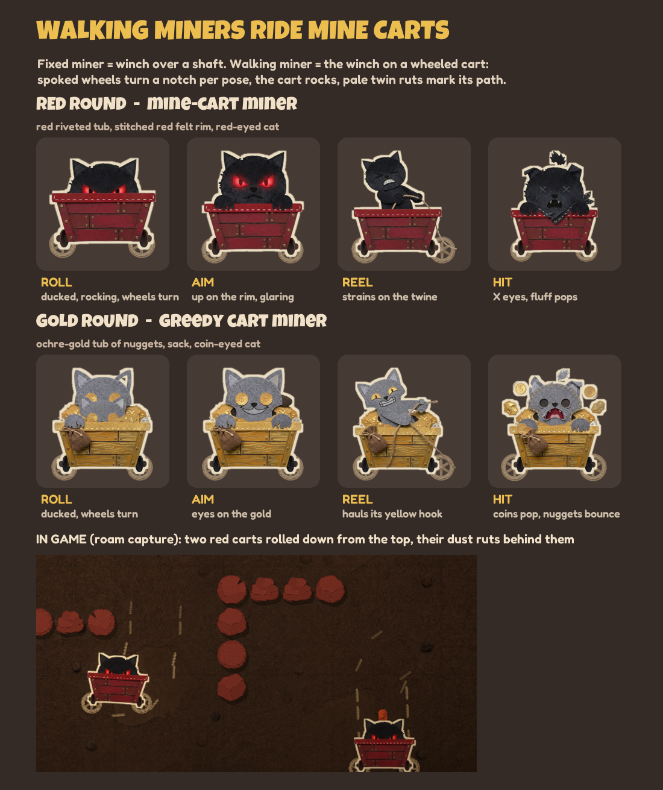

# Roam level villains: the Evil Meowmeow's henchmen

All three are felt Meowmeows from the same family as the miner cats (charcoal felt, dashed stitches,
triangle ears, glowing red or gold eyes), painted with Meshy image-to-image from `Miner/MinerGlare.png`
or `Miner/MinerEager.png`. They are art only: gameplay, colliders, sizes, speeds and timing stay as they are.

## Red Square: "Brawler Meowmeow" (built)

The Red Square rams the player, so it is drawn as a fighter rather than a block. It is a stocky,
wide-shouldered cat with big red felt boxing gloves, a red headband with flying tails, a scarred
cheek and a fang. A cream cut-paper margin keeps the charcoal felt readable on the dark mine floor.
The square's 1x1 box collider is unchanged; the figure is drawn about 1.5 world units across.

| Pose | When | Sprite |
| --- | --- | --- |
| Guard | asleep, standing, backing off after a hit | `Enemies/Brawler_Guard` |
| Walk | moving: tipped one way, Guard, tipped the other way, Guard, one picture per pose beat | `Brawler_Guard_w1/_w2` |
| Wind-up | hunting and within 1.8 units of the player: crouched, glove cocked back | `Brawler_Windup` |
| Punch | the frame a ram lands, held 0.3 s: glove thrust at the camera, paper speed strips | `Brawler_Punch` |
| Bonk | the ram was blocked (Mr. Hyde's block), or it is shoved by the pig's attack: dizzy, stars | `Brawler_Bonk` |
| (frozen) | Elsa's frost: holds whatever pose and facing it was caught in until it thaws, and the whole brawler turns ice-blue like the frozen miner cats (any patch freezes all of it); the frost patch draws over it | - |

`PaperBrawler` swaps the square's own root sprite and its flipX, so it faces the player. Hits change the
picture at once; every other change waits for the next stop-motion pose. HookHealth's hit blink and
FrostBody2D's frost keep working because they read that same renderer. The only gameplay-file edits
are read-only state getters (`RedSquare.Rammed / Recovering / LastRamBlocked / Target`,
`RedEnemy.BeingPushed`) and the line that adds the art component.

Regenerate the sprites with `python tools/art/make_brawler.py` from the Meshy sources in
`docs/images/roam-enemies/brawler_*.png`. Check them in game with
`tools/art_capture/capture.ps1 -Scenes "level_roam:brawler" -Frames 24`. The `brawler` capture
action puts the player three steps from the nearest Red Square and wakes it.

## Walking miners: Red Round and Gold Round ride mine carts (built)

A fixed miner works a winch over a timber shaft (`PaperMiners`). The walking hook holes used to get
that same shaft and winch dragged beside the old red disc, which read as a solid block, not as
something that moves. A shaft cannot walk, so the walkers are drawn as their own enemy: a felt
Meowmeow riding a **mine cart** with its winch on board. Wheels say "mobile" even while it stands.
(An earlier idea, a cat in a travelling burrow mound, was dropped for the same reason: a mound reads
as a hole that stays put.)

- **Red Round:** a red riveted cart tub with a red felt rim stitched in white, and the red-eyed cat
  with its red bandana.
- **Gold Round:** an ochre-gold tub heaped with nuggets, with a sack on the side, and a grey cat with
  gold-coin eyes.

| Pose | When | Sprite |
| --- | --- | --- |
| Roll | moving: ducked to the ears; the cart rocks +-3 degrees over bumps on the beat | `Cart{Red,Gold}_Lurk`, `_Lurk_w1/_w2` |
| Lurk | standing | `Cart*_Lurk` |
| Aim | the hook's telegraph (`SurvivalHookAI.Aiming`): up on the rim, glaring | `Cart*_Aim` |
| Reel | hook out (`Hook.IsBusy`): standing in the cart, straining on the twine | `Cart*_Reel` |
| Hit | while `HookHealth` blinks: X eyes / coins popping | `Cart*_Hit` |
| (frozen) | Elsa's frost: holds its pose and facing; the whole cart (cat, tub, wheels) turns ice-blue like the frozen miner cats; the dust ruts never frost | - |

`PaperMineCart` swaps the hole's own root sprite, flip and sorting order, and adds collider-free
children, so the hole's collider (fitted to the old disc), HP blink, frost, hook and every gameplay
value are unchanged.
- **Wheels:** the tub is painted without wheels. Two spoked wheels (`Miner/WinchReel`) are separate
  cut-outs behind the tub's lower corners, and they turn 40 degrees per pose in the direction of travel.
- **Ruts:** pale dust ruts (`Fx/Stitch`) are left in pairs every 0.3 units and fade over 1.4 s, so a
  cart's path shows even in a still frame.
- **Sorting:** the cat sits in front of its resting brass claw and behind its rope while the hook is
  out, with the shaft cats' orders (rope +7 / rope -2).
- **Facing:** it faces its target (the player, or the gold for a Gold Round).

`PaperMiners` now leaves walking holes alone. `RedRound` and `GoldRound` attach the art, and
`HookHealth.Blinking` is the only gameplay-file addition: a read-only getter.
Sprites: `python tools/art/make_cart.py` (sources `images/roam-enemies/cart_*.png`). Capture:
`level_roam:round` puts the player near a walking miner and, for review, spawns a Gold Round through
the loader's own `AddGoldRound`.

## Needle Meowmeow: the sprint-stab cat (look and prefab built, gameplay not written)

A lean, long-legged felt fencer cat in a red bandit mask. Its rapier is a giant steel sewing needle on
red thread, a weapon from the game's own felt-and-stitch world. It is drawn in side view, like the rhino
and penguin heroes, and its lean outline is the opposite of the stocky brawler's, so the two read
apart at a glance. Like the brawler, it has a cream cut-paper edge, but only on the solid body: thin
thread and the needle stay bare.

**Prefab:** `Assets/Prefabs/Enemy/NeedleMeowmeow.prefab`, built by
`Tools > Gold Miner > Art > Build Needle Meowmeow Prefab` (`Assets/Editor/Art/NeedleMeowmeowPrefab.cs`).
It is look only, with no collider, Rigidbody or gameplay script. The root holds `NeedleMeowmeowArt`:

| Child | What |
| --- | --- |
| Body | SpriteRenderer with the pose pictures, drawn at 0.75 (prowl about 1.45 units nose to needle tip). The only part that flips and tilts, so a physics root can be added later |
| Thread | world-space LineRenderer, twine texture, red: the thread the needle sews along a dash |
| Telegraph | the wind-up's red running stitch (Fx/Stitch) along the sprint path, made at runtime |

**How the gameplay script drives it** (it never moves the root):

| Call | Picture |
| --- | --- |
| `Aim(dir)` | faces the sprint (flipX); the dash and stab tilt toward it, up to 35 degrees |
| `SetPose(Prowl)` | stalking; bobs and leans on the shared stop-motion beat |
| `SetPose(Windup)` + `telegraphLength` | low sprinter's crouch; a red stitch line marches out along the path. Set the length to the sprint distance |
| `SetPose(Dash)` | flying horizontal lunge; red thread is sewn on the floor behind it |
| `SetPose(Stab)` | full fencing lunge with a star burst at the needle tip: the hit frame |
| `SetPose(Stuck)` | a miss: needle stuck in the floor, tangled thread, tugging. This is the player's opening |
| `SetPose(Hit)` | thrown back, X eyes, needle flying loose |

The sewn thread stays on the floor after the dash and fades over 1.2 s, in held steps. Attack poses
change on the frame they are set; the bob and the marching stitches wait for the beat. **Preview
Cycle** (Inspector) plays the whole attack in a loop for review. The capture action `world_map:needle`
films it.

Suggested gameplay hooks, for whoever writes it: telegraph about 0.9 s, dash about 0.35 s, stab
0.35 s, stuck about 0.9 s as the punish window. These are only the timings the art was reviewed at;
the real values are the gameplay owner's call. HookHealth will find the Body renderer for its hit blink.

Sprites: `python tools/art/make_needle.py` (sources `images/roam-enemies/needle_*.png`).

## World map: the Burrow Bandit with a grapple (built)

The parked burrow design from the sheet above is now built, for the world map's two eye miners. They are
a different enemy from the level miners: their hooks stop at the first rock they touch
(`hook_wall_grace 0`), while level hooks fly over rocks. So they get their own look, and their hook says
why:

- **The cat** (`PaperMiners`, map mode): a charcoal felt Meowmeow with a red bandana in a torn-paper earth
  mound (`Burrow/Duck`, `Aim`, `Pull`; `Hurt` is cut for later). It ducks with glowing eyes while the hook
  rests, pops up glaring while it shoots, and strains while it reels in. There's no timber shaft, winch or
  rim cat. The mound takes the shaft frame's footprint (1.25x the rock-fitted miner size), and it tips on
  the shared beat. Frozen by Elsa, it turns ice-blue and holds its pose. The Pull painting's hemp rope was
  inpainted away (`tools/art/make_burrow.py`), since the chain comes out of the burrow.
- **The hook** (`PaperClaws`, map mode): a forged-iron four-prong grappling hook with a red felt wrap
  (`Fx/Grapple`). Its eye ring sits on the line's end, and it points along the shot, drawn as long as the
  brass claw. The line is an iron chain (`Tiles/Chain`, a seamless two-link tile) instead of the two-ply
  twine. Both have a cream cut-paper edge so they read on the dark floor, and both are only lightly tinted
  toward the hook's colour. Iron that bites into rock is the hint that these hooks are stopped by rock.

Art only: hook speed, cooldown, colliders and the rock rule are unchanged (the map's timings are
`hook_extend`, `hook_retract` and `cooldown` in `Hub/world_map.json`, owned by gameplay).
Sprites: `python tools/art/make_burrow.py` and `python tools/art/make_grapple.py`
(sources `docs/images/roam-enemies/red_round_*.png`, `grapple_pieces.png`). Capture: `world_map:eyes`
stands the player on the eye gold nearest a miner, so it shoots.

