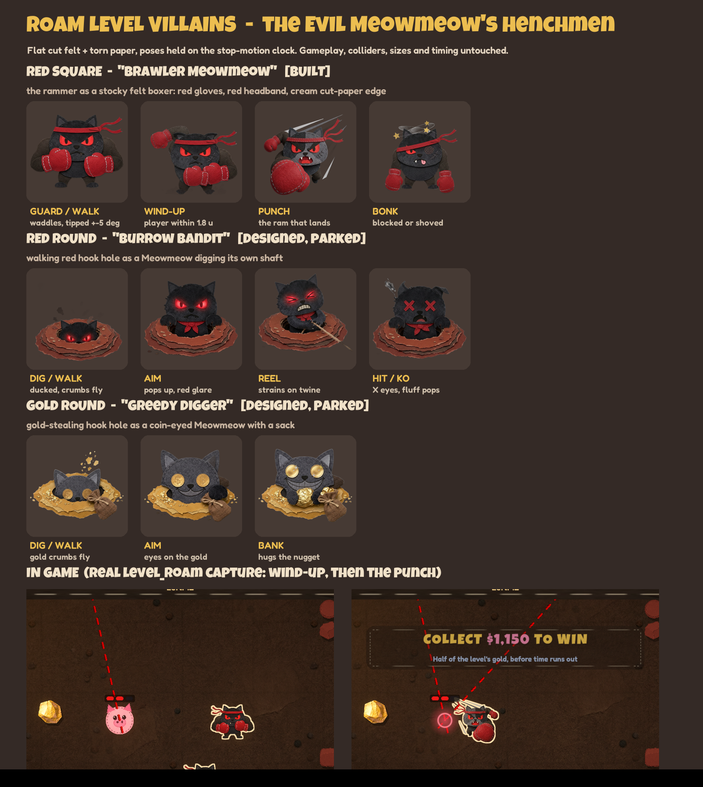
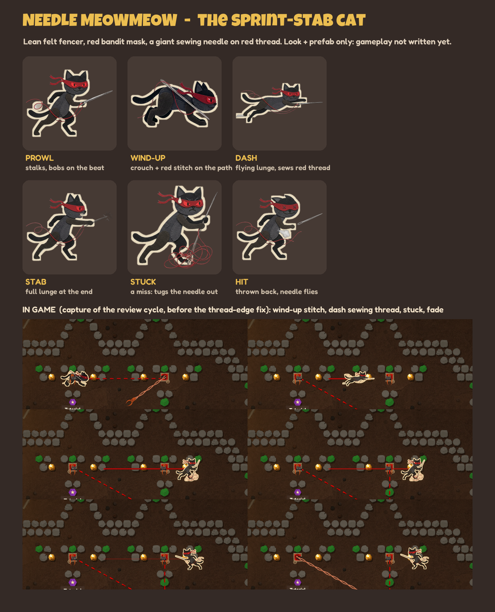

# Roam level villains: the Evil Meowmeow's henchmen

All three are felt Meowmeows from the same family as the miner cats (charcoal felt, dashed stitches,
triangle ears, glowing red or gold eyes), painted with Meshy image-to-image from `Miner/MinerGlare.png`
or `Miner/MinerEager.png`. They are art only: gameplay, colliders, sizes, speeds and timing stay as they are.

## Red Square: "Brawler Meowmeow" (built)

The Red Square rams the player, so it is drawn as a fighter rather than a block. It is a stocky,
wide-shouldered cat with big red felt boxing gloves, a red headband with flying tails, a scarred
cheek and a fang. A cream cut-paper margin keeps the charcoal felt readable on the dark mine floor.
The square's 1x1 box collider is unchanged; the figure is drawn about 1.5 world units across.

| Pose | When | Sprite |
| --- | --- | --- |
| Guard | asleep, standing, backing off after a hit | `Enemies/Brawler_Guard` |
| Walk | moving: tipped one way, Guard, tipped the other way, Guard, one picture per pose beat | `Brawler_Guard_w1/_w2` |
| Wind-up | hunting and within 1.8 units of the player: crouched, glove cocked back | `Brawler_Windup` |
| Punch | the frame a ram lands, held 0.3 s: glove thrust at the camera, paper speed strips | `Brawler_Punch` |
| Bonk | the ram was blocked (Mr. Hyde's block), or it is shoved by the pig's attack: dizzy, stars | `Brawler_Bonk` |
| (frozen) | Elsa's frost: holds whatever pose and facing it was caught in until it thaws; the frost draws over it | - |

`PaperBrawler` swaps the square's own root sprite and its flipX, so it faces the player. Hits change the
picture at once; every other change waits for the next stop-motion pose. HookHealth's hit blink and
FrostBody2D's frost keep working because they read that same renderer. The only gameplay-file edits
are read-only state getters (`RedSquare.Rammed / Recovering / LastRamBlocked / Target`,
`RedEnemy.BeingPushed`) and the line that adds the art component.

Regenerate the sprites with `python tools/art/make_brawler.py` from the Meshy sources in
`docs/images/roam-enemies/brawler_*.png`. Check them in game with
`tools/art_capture/capture.ps1 -Scenes "level_roam:brawler" -Frames 24`. The `brawler` capture
action puts the player three steps from the nearest Red Square and wakes it.

## Red Round: "Burrow Bandit" (designed, parked, not built)

The walking red hook hole is a Meowmeow that digs its own shaft as it goes. It rises out of a round
mound of torn paper soil, wearing a red bandana, with glowing red eyes.
Poses: Dig/Walk (ducked, so only the ears and eyes show; torn-paper crumbs fly up and are left on the
floor), Aim (pops up with a red glare on the telegraph), Reel (straining on the twine), Hit/KO (X eyes,
felt fluff pops off, then the mound collapses).
Note from the game-scale mock-up: rust-red soil blends with red-tinted wall rocks. When this is built,
use umber soil and keep the red to a stitched felt ring, the bandana and the eyes.
Sources: `images/roam-enemies/red_round_*.png`.

## Gold Round: "Greedy Digger" (designed, parked, not built)

The gold-collecting walker is the same burrowing cat in a gold-sand mound. It has gold-coin eyes with
stitched dollar signs, a greedy grin and a burlap sack, a cousin of the Greedy Meowmeow.
Poses: Dig/Walk (ducked, gold crumbs fly), Aim (eyes on the gold), Bank (hugs the nugget, sparkle eyes).
Sources: `images/roam-enemies/gold_round_*.png`.

## Needle Meowmeow: the sprint-stab cat (look and prefab built, gameplay not written)

A lean, long-legged felt fencer cat in a red bandit mask. Its rapier is a giant steel sewing needle on
red thread, a weapon from the game's own felt-and-stitch world. It is drawn in side view, like the rhino
and penguin heroes, and its lean outline is the opposite of the stocky brawler's, so the two read
apart at a glance. Like the brawler, it has a cream cut-paper edge, but only on the solid body: thin
thread and the needle stay bare.

**Prefab:** `Assets/Prefabs/Enemy/NeedleMeowmeow.prefab`, built by
`Tools > Gold Miner > Art > Build Needle Meowmeow Prefab` (`Assets/Editor/Art/NeedleMeowmeowPrefab.cs`).
It is look only, with no collider, Rigidbody or gameplay script. The root holds `NeedleMeowmeowArt`:

| Child | What |
| --- | --- |
| Body | SpriteRenderer with the pose pictures, drawn at 0.75 (prowl about 1.45 units nose to needle tip). The only part that flips and tilts, so a physics root can be added later |
| Thread | world-space LineRenderer, twine texture, red: the thread the needle sews along a dash |
| Telegraph | the wind-up's red running stitch (Fx/Stitch) along the sprint path, made at runtime |

**How the gameplay script drives it** (it never moves the root):

| Call | Picture |
| --- | --- |
| `Aim(dir)` | faces the sprint (flipX); the dash and stab tilt toward it, up to 35 degrees |
| `SetPose(Prowl)` | stalking; bobs and leans on the shared stop-motion beat |
| `SetPose(Windup)` + `telegraphLength` | low sprinter's crouch; a red stitch line marches out along the path. Set the length to the sprint distance |
| `SetPose(Dash)` | flying horizontal lunge; red thread is sewn on the floor behind it |
| `SetPose(Stab)` | full fencing lunge with a star burst at the needle tip: the hit frame |
| `SetPose(Stuck)` | a miss: needle stuck in the floor, tangled thread, tugging. This is the player's opening |
| `SetPose(Hit)` | thrown back, X eyes, needle flying loose |

The sewn thread stays on the floor after the dash and fades over 1.2 s, in held steps. Attack poses
change on the frame they are set; the bob and the marching stitches wait for the beat. **Preview
Cycle** (Inspector) plays the whole attack in a loop for review. The capture action `world_map:needle`
films it.

Suggested gameplay hooks, for whoever writes it: telegraph about 0.9 s, dash about 0.35 s, stab
0.35 s, stuck about 0.9 s as the punish window. These are only the timings the art was reviewed at;
the real values are the gameplay owner's call. HookHealth will find the Body renderer for its hit blink.

Sprites: `python tools/art/make_needle.py` (sources `images/roam-enemies/needle_*.png`).
