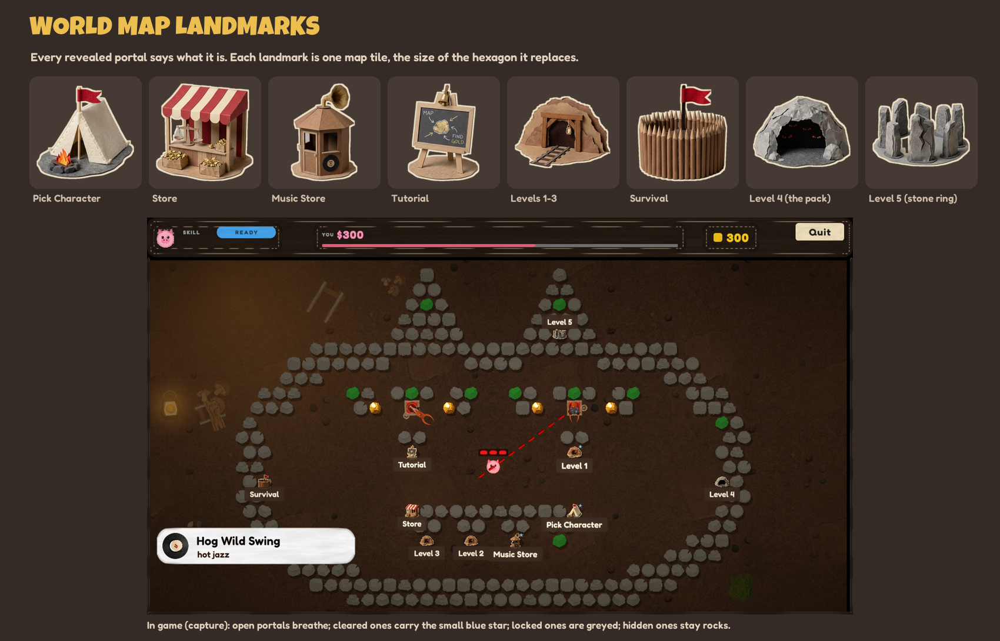

# World map landmarks

The map's portals were anonymous violet hexagons with a star, with only the name tag to say what
each one was. Each revealed portal now shows a landmark in the keyframe's cut-paper style:

| Node | Landmark |
| --- | --- |
| Pick Character (`role_pick`) | the camp shelter: a felt tent with a campfire and red pennant (the camp you walk into) |
| Store (`store_1`) | a market stall with a striped paper awning, scales and crates of gold |
| Music Store (`music_store`) | the record kiosk with a brass gramophone horn and a record on the front |
| Tutorial (`battle_03`) | the school: a chalkboard easel with a chalk gold nugget and a little bell |
| Levels 1-3 (other battles) | a timber mine entrance with rails and a lantern |
| Survival (`survival`) | a log fort with a red flag |
| Level 4 (`battle_05`, the roam map) | the pack's lair: a cave with red eyes glowing in the dark |
| Level 5 (`battle_07`, the ring) | a stone ring with one cracked boulder |

`PaperLandmarks` is art only.
- **Contract:** it follows the same rule as `PaperPortalStones`. The portal's Star renderer is the
  signal: off means still a disguised rock, so nothing changes and secrets hold; on means revealed.
- **Once revealed:** the hexagon and star are switched off (`forceRenderingOff`, which `HubPortal`
  never touches), and the landmark shows as the portal's child. It grows with the reveal and breathes
  with an open portal, because `HubPortal` scales the portal.
- **Size:** each landmark is **one map tile**, the size of the hexagon it replaces and of the wall
  rocks, so the honeycomb keeps its rhythm and the name tags stay where they were.
- **State:** read from the hexagon's own colour. Locked is greyed, cleared gets a small blue paper
  star, and open is full colour.
- No gameplay field is read or changed.

Sprites: `python tools/art/make_landmarks.py` cuts `docs/images/landmarks/sheet_{a,b}.png` (two Meshy
2 x 2 sheets) into `Art/Landmarks/*`.

## One game

Branch `art/world` combines every art branch on the latest main: the music art (`art/music`), the
roam enemies (`art/roam-enemies`: brawler Red Square, mine-cart miners, frozen hold) and the camp
(`art/camp`). The only merge conflicts were doc rows and capture actions. One build covers the menu,
the camp, the roam level, the music store and the map, with no errors.
